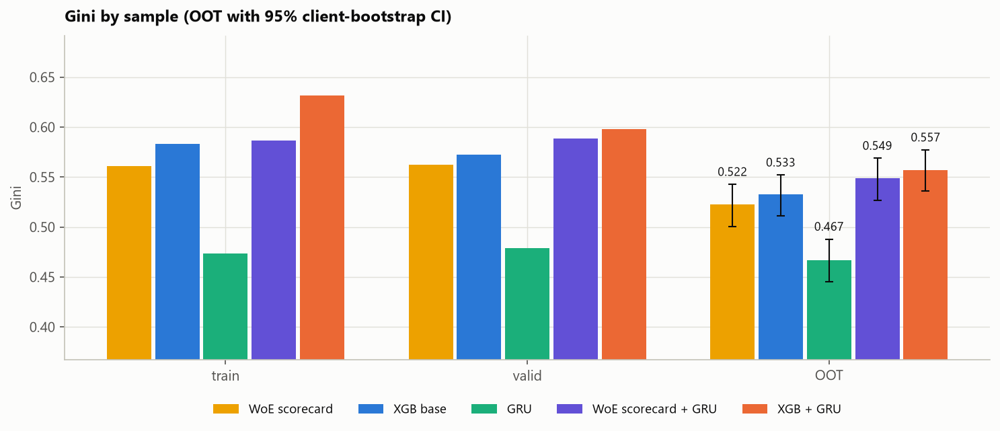
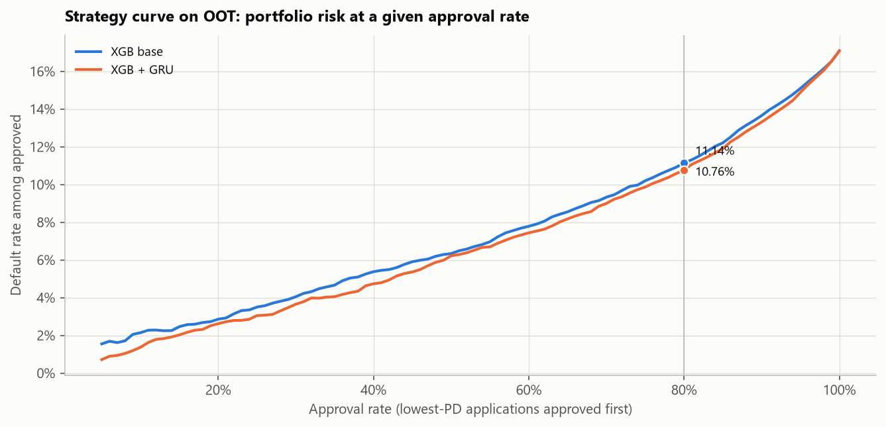
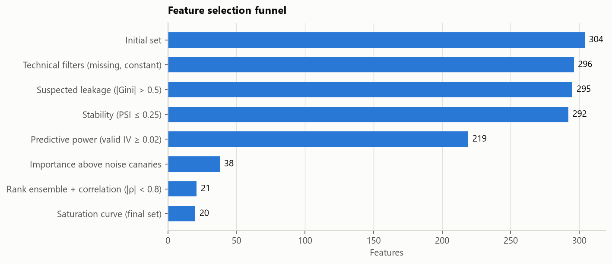
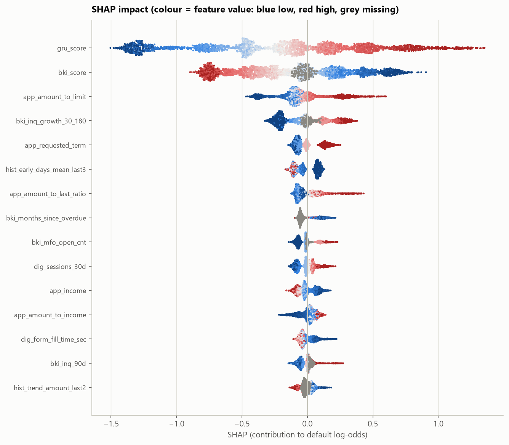
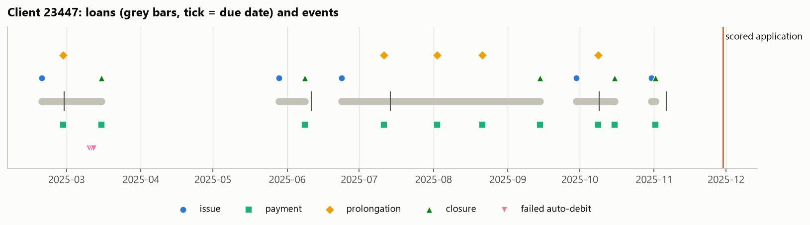

# Credit scoring for repeat borrowers: a GRU over the raw event history + feature selection + XGBoost

A PD model (NPL30d90) for repeat clients of a short-term consumer lender. Three ideas:

1. **A GRU reconstructs a feature from the client's raw event sequence.** Loan issues, payments, prolongations, closures and auto-debits become tokens, and a recurrent network folds them into one number — `gru_score`, an out-of-fold logit with folds by client.
2. **Feature selection** from 300+ candidates: technical filters → leakage → stability (PSI) → IV on valid → gain / SHAP / permutation against noise "canaries" → MRMR → rank ensemble → correlation → saturation curve.
3. **XGBoost** on the selected features + `gru_score` (stacking). Optuna with a *penalized valid Gini* objective, comparison with XGBoost without the GRU, the GRU alone and a WoE scorecard, client-level bootstrap of ΔGini.

The whole path — from raw events to PD, risk grades and business impact — is in one notebook:
[`notebooks/credit_scoring_gru_xgboost.ipynb`](notebooks/credit_scoring_gru_xgboost.ipynb).

## Results

OOT — 16.8k applications from 2026-01…04 that took no part in feature selection or tuning. Confidence intervals: client-level bootstrap, 500 draws.

| Model | Features | Gini train | Gini valid | **Gini OOT** [95% CI] | KS OOT |
|---|---|---|---|---|---|
| WoE scorecard | 20 selected | 0.561 | 0.563 | 0.522 [0.501; 0.543] | 0.386 |
| XGBoost base | 20 selected | 0.583 | 0.573 | 0.533 [0.511; 0.552] | 0.397 |
| GRU | raw event history only | 0.474 | 0.479 | 0.467 [0.445; 0.488] | 0.354 |
| WoE scorecard + GRU | 20 + `gru_score` | 0.587 | 0.589 | 0.549 [0.527; 0.569] | 0.406 |
| **XGBoost + GRU** (final) | 20 + `gru_score` | 0.631 | 0.598 | **0.557** [0.536; 0.577] | 0.415 |

- **The GRU feature adds +0.024 Gini on OOT** (95% CI [+0.019; +0.031]) over the same booster without it. The gain is significant in every segment: L2 +0.037, L3 +0.021, L4+ +0.015. It is largest where the history is short and tabular history aggregates have little to work with.
- **Source vs complexity are separated.** `gru_score` adds +0.026 to the scorecard. Boosting on top of the scorecard adds +0.010 without the GRU and +0.008 with it. Both effects are significant, but the main gain comes from the new information source, not from the model.
- **Feature selection: 304 → 20.** Removed:
  - the leakage (univariate Gini 0.98);
  - three drifting fields (PSI 3–16);
  - empty and constant fields;
  - 181 features that did not beat the noise canaries;
  - duplicates with |ρ| ≥ 0.8.
- **Stability.** Risk grades are strictly monotonic on train / valid / OOT, score PSI train → OOT < 0.001, numpy GRU inference matches torch to 5·10⁻⁷.
- **Business impact.** At 80% approval the default rate among approved loans falls from 11.1% to 10.8% (−3.4% relative).

<p align="center">
 
 
</p>

## Why the GRU adds value

The feature factory computes aggregates **at the loan level**: delinquency, number of prolongations, days of early repayment, partial payments, amounts. The order and timing of events inside a loan are lost. The data contain a hidden factor — the client's *liquidity stress*. It barely affects loan outcomes, but it shows in the micro-dynamics:
- the obligation is settled in the last hours of the due date;
- the payment goes through a failed morning auto-debit and a partial collection;
- a prolongation is taken at the very last moment.

The GRU sees the exact time and type of every token and recovers this factor; the factory aggregates do not. Real data work the same way: a feature factory never covers every pattern, while a new event type plugs into the GRU as one more token flag, without manual feature engineering.

## Methodological choices

| Choice | Why |
|---|---|
| **Point-in-time** for every feature and token; a test recomputes features on history truncated at the application time | no leakage from the future. The test caught a real bug during development: an array assigned without index alignment |
| **Valid split by client**, not by application | with shared clients, valid rewards models that memorise people |
| **GRU OOF folds by client** + early stopping on an inner split of the fold | `gru_score` on train must not be "peeked", otherwise the booster overweights it |
| **OOT is used neither in selection nor in tuning**; PSI is computed over development months | an honest final estimate |
| **IV on valid** with bins fitted on train | IV on train is inflated for overfitted bins |
| **Noise canaries** in model-based importance | a signal/noise threshold that accounts for interactions instead of an arbitrary top-N |
| **Saturation curve on 3 client folds** | a single valid sample is too noisy (Gini SE ≈ 0.01) to compare feature sets |
| **Penalized valid Gini** in Optuna: penalty 0.5 for a train−valid gap above 0.03 | steers the search towards configurations that transfer to OOT |
| **Client-level bootstrap** for ΔGini | applications of the same client are dependent; a row bootstrap understates intervals |
| **WoE scorecard with and without `gru_score`** as baselines | separates the gain from the new information source and the gain from model complexity |
| **GRU inference in numpy** + parity check with torch | production does not need torch; scoring one application is a loop over ≤128 tokens |

## Synthetic data

The generator (`src/scoring/synth.py`) simulates a portfolio of repeat clients for 2024-01 … 2026-04:
- each client has a hidden credit risk `z`: drift, random walk, rare shocks;
- a hidden liquidity stress `l` — an AR(1) process over loans;
- an external debt load `e` drives the bureau data;
- loan behaviour is a noisy observation of these factors: early repayment, prolongations, delinquency, partial and reversed payments, payment hours, auto-debits. Habits unrelated to risk (some people always pay at night) add noise;
- a few interactions an additive scorecard cannot express (e.g. external debt hurts low incomes most);
- loans are turned into a raw event stream in DWH format, and 300+ features are built from it;
- a macro shift from autumn 2025 raises the default rate in OOT;
- traps for feature selection: leakage (`coll_calls_cnt_90d` — a window counted from the report date instead of the application date), a bureau score rescale, a growing app version, a new acquisition channel, fields with 95–98% missing, quasi-constants, duplicates in other units.

Volume:
- 57.7k repeat applications: L2 — 20.8k, L3 — 13.3k, L4+ — 23.6k;
- 23.4k clients, 120k loans in history, 681k events, 304 features;
- NPL30d90 default rate — 15.2% in 2025 and 17.1% in OOT.

If the hidden risk factors were known exactly, the OOT Gini would be ≈ 0.71. This is the ceiling given the built-in noise.

<p align="center"></p>

## Structure

```
src/scoring/
  synth.py        generator: clients → loans → event stream → bureau / application / digital snapshots
  features.py     300+ point-in-time features: events → loan summary → window aggregates; PIT recompute
  sequences.py    events → "loan + minute" tokens, sequence index per application
  gru.py          multi-task GRU, client-level OOF, numpy inference
  selection.py    selection funnel: filters, WoE/IV, PSI, gain/SHAP/permutation, canaries, MRMR, ranks, saturation
  modeling.py     Optuna (penalized Gini), final XGBoost, bootstrap, WoE scorecard
  metrics.py      Gini, KS, PSI, risk grades, calibration, approval curve
  plots.py        charts in one style
notebooks/credit_scoring_gru_xgboost.ipynb   the final notebook (executed, with outputs)
scripts/generate_data.py                     data generation into data/
tests/                                       PIT of features and tokens, metrics, WoE/IV, numpy-GRU parity
reports/figures/                             every chart from the notebook
artefacts/                                   models, GRU weights, model_card.json
```

## How to run

```bash
python -m venv .venv
.venv\Scripts\pip install torch==2.15.0 --index-url https://download.pytorch.org/whl/cpu
.venv\Scripts\pip install -r requirements.txt
.venv\Scripts\python scripts\generate_data.py
.venv\Scripts\python -m pytest tests
.venv\Scripts\python -m jupyter nbconvert --to notebook --execute --inplace notebooks\credit_scoring_gru_xgboost.ipynb
```

The notebook runs on a laptop CPU in about 15 minutes: GRU ~2.5 min, feature selection ~2.5 min, Optuna ~5 min. Paths are for Windows; on Linux/macOS use `.venv/bin/...`.

Optuna trials run in parallel, so the tuned hyperparameters and booster metrics may differ slightly between runs. Data generation, the GRU and feature selection are deterministic.

## Limitations

- The data are synthetic. Absolute Gini values depend on the generator parameters; what matters are the model comparisons and the methodology.
- On OOT the PD level is below the observed rate because of the built-in macro shift; recalibration on a recent window is needed before deployment.
- One model for all segments, with the loan number as a feature; quality is reported by L2 / L3 / L4+.
